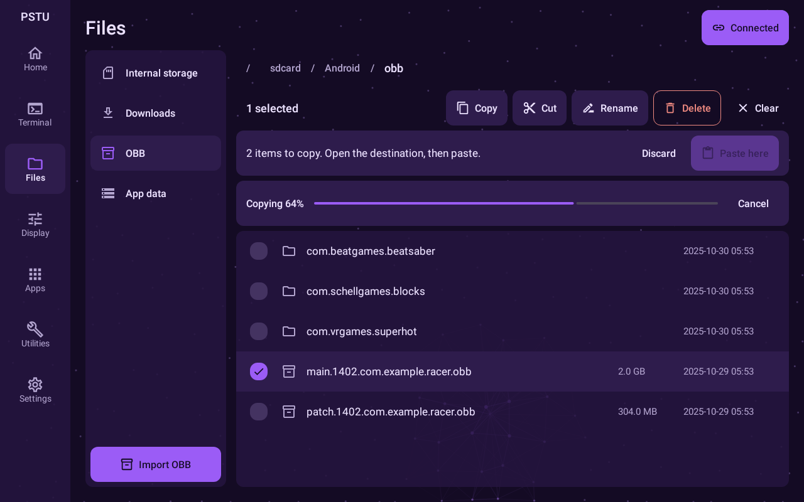

# Pasteularity

A non-root utility toolbox for standalone Meta Quest headsets. It runs as a normal 2D panel on Horizon OS and gets shell-level (uid 2000) access through Wireless debugging or ByteZuku.



More screens are in [docs/screenshots](docs/screenshots). They are rendered from the real Compose code with sample data.

## What it does

- **Home**: open Android's own Settings screens, reboot (with bootloader and recovery under Advanced), toggle the proximity sensor.
- **Terminal**: shell console with scrollback, command history, copy, clear and saved snippets.
- **Files**: browse the filesystem including `Android/obb` and `Android/data`. Multi-select, copy, cut, paste, rename, delete, new folder, OBB import, progress on large copies.
- **Display**: refresh rate, texture size, foveation and CPU/GPU levels, with per-setting reset, global reset and named profiles. These are for people who know the right values for their hardware, and the screen says so.
- **Apps**: list and search apps. Launch, force stop, clear cache or data, uninstall, open folders, export APK, and install an APK with its OBB.
- **Utilities**: device info, screenshot and recording, logcat viewer, Wi-Fi ADB details, reversible tweaks.

It does not include anything that bypasses Meta account checks, DRM or paid content.

## Build

You need JDK 17 and the Android SDK with platform 34. Android Studio includes both. Open the project in Android Studio, or point `local.properties` at your SDK and run:

```bash
./gradlew :app:assembleRelease
```

On Windows, use `gradlew.bat` and set `JAVA_HOME` to a JDK 17 first if your default Java is newer. The build tools do not run on very new JDKs.

The APK is written to `app/build/outputs/apk/release/app-release.apk`.

**Use the release build on a headset.** A debug build (`:app:assembleDebug`) is several times slower because Android does not optimize debuggable apps, and it lags badly on anything that updates quickly.

### Signing

Without your own key, the release build is signed with this PC's debug key. That is fine for your own headset, and it installs over a debug build without losing your pairing or settings.

Before you share the APK, create a key and add a `keystore.properties` file next to `settings.gradle.kts`. It is git-ignored:

```properties
storeFile=pasteularity.jks
storePassword=your-password
keyAlias=pasteularity
keyPassword=your-password
```

Keep the key safe. Android refuses to update an app signed with a different key.

### Install

From a PC, with the headset plugged in and USB debugging allowed:

```bash
adb install -r app/build/outputs/apk/release/app-release.apk
```

Sideloaded apps appear in the headset's library under Unknown Sources.

## Wireless debugging setup

The app walks through this on first launch.

1. In the Meta Horizon phone app, open your headset's settings and turn on Developer Mode.
2. In Pasteularity, select **Open Developer options** and place that window next to Pasteularity.
3. Turn on **Wireless debugging**. The headset must be on Wi-Fi.
4. Select **Wireless debugging**, then **Pair device with pairing code**.
5. Enter the six-digit code in Pasteularity. The port fills in automatically; if it does not, copy the number after the colon from the dialog.

You only pair once. After that, Pasteularity reconnects by itself whenever Wireless debugging is on. Android may turn Wireless debugging off when the headset changes Wi-Fi network or reboots, and turning it back on is enough.

To revoke access, select **Forget pairing** in Settings and remove the device under Wireless debugging in Developer options.

### ByteZuku

If ByteZuku is installed and running, Pasteularity offers it during setup and in Settings. Automatic mode uses Wireless debugging when it is connected and ByteZuku otherwise.

ByteZuku is a Shizuku fork that keeps the Shizuku binder protocol, so the app talks to it through the upstream `dev.rikka.shizuku` client library. That library's names (`rikka.shizuku.*`, the `.shizuku` provider authority) are the only Shizuku mentions left, and they have to stay because ByteZuku's server looks for them.

## Android Settings on Horizon OS

On current firmware (checked on Horizon OS v207), Meta has made the Settings home page (`com.android.settings/.Settings`) private, so neither apps nor shell can open it. The normal settings intent goes to Meta's own settings app instead.

The sections inside it are still open, so **Open Android Settings** lists them and launches each one directly: Network, Apps, Display, Developer options and so on. If a future firmware opens the home page again, the button goes straight there.

## Project layout

```
shell/            ShellBackend interface, ShellManager, ADB and ByteZuku backends,
                  exit-code protocol, quoting, firmware error handling
data/             Saved settings, snippets and profiles
features/<name>/  One package per screen: state, ViewModel, screen
ui/theme/         Colours, type scale, shape
ui/components/    Button, choice row, setting row, action card, dialogs, status chip,
                  output list, dot web background
```

Features only ever see a `ShellBackend`. `ShellManager` implements that interface and forwards to whichever backend is active, so a feature cannot tell ADB and ByteZuku apart.

## Safety rules in the code

- Every user-supplied value goes through `shellQuote`. The one exception is the Terminal, where running raw commands is the purpose.
- Quest-specific commands go through `firmwareCommand` or `setPropVerified`, which report "Not supported on this firmware" instead of crashing. Properties are read back after setting, because `setprop` does not always report a refusal.
- Deleting the top-level storage folders is refused in the repository layer, as well as being confirmed in the UI.
- **Clear cache** only clears an app's external cache. `pm clear --cache-only` is avoided on purpose: firmware that does not know the flag can ignore it and wipe all of the app's data.

## Performance rules in the code

- Streams (logcat, terminal) are read and parsed off the main thread, and the screen updates a few times a second at most.
- Log and terminal lines only allow text selection when the output is paused or stopped. Selection is too slow while lines are arriving.
- App icons are drawn once at a fixed small size, off the main thread, and cached.
- The dot web has its own graphics layer and draws nothing while the pointer is still.

## Intro video

[docs/pasteularity-intro.mp4](docs/pasteularity-intro.mp4) is a 24-second, silent 1080p60 introduction, with a copy under 10 MB at `docs/pasteularity-intro-discord.mp4` for Discord. `tools/intro-video` renders it as real 3D in WebGL, using Node and an installed Chrome or Edge. It needs no other tools, and it encodes on the GPU. Each frame blends up to 32 renders for motion blur and focus, and the whole video still takes about a minute.

The plan for each tab, meaning where the window lands, how it gets there and what the pointer does once it is there, is in `STAGES` and `SCRIPTS` near the top of `tools/intro-video/scene.js`.

After changing the UI, update `docs/interactive-preview.html`, then rebuild both files:

```bash
node tools/intro-video/capture-parts.mjs
```

```bash
node tools/intro-video/render.mjs video docs/pasteularity-intro.mp4 12
```

```bash
node tools/intro-video/render.mjs video docs/pasteularity-intro-discord.mp4 3.1
```

## Tests

```bash
./gradlew :app:testDebugUnitTest
```

This covers quoting and injection, exit-code parsing, file listing, log filtering and output parsing. To regenerate the screenshots in `app/build/outputs/preview`, add `-Proborazzi.test.record=true`.
